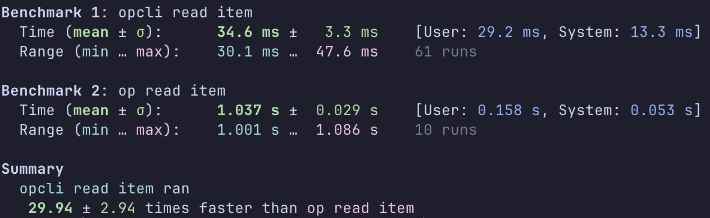

<p align="center"></p>

# opcli

A fast, local 1Password CLI alternative. Reads directly from 1Password's local SQLite database instead of making network calls.

opcli started as a faster `op`, and the commands they share look alike. But it is not a strict drop-in replacement. I build it for how I work, which is mostly through AI coding agents that run commands on my behalf, and where that calls for something `op` doesn't do, opcli goes its own way. See [Differences from `op`](#differences-from-op).

## Performance

~30x faster than the official `op` CLI:



## How it works

1. Gets your account password from you, saves it in Keychain
2. Reads the local 1Password SQLite database
3. Derives the Account Unlock Key using 2SKD (HKDF + PBKDF2)
4. Decrypts the keyset chain (AES-256-GCM + RSA-OAEP)
5. Decrypts vault keys and item data

No network calls. No IPC with the desktop app. Just direct crypto.

## Installation

Download the [latest release](https://github.com/jeremyschlatter/opcli/releases/latest) from GitHub and unpack it. You get `opcli.app`; the command is inside it, so put a symlink to it on your `PATH`:

```bash
ln -s /path/to/opcli.app/Contents/MacOS/opcli ~/bin/opcli
```

Keep the bundle intact. opcli is a command-line tool, but macOS only lets it into its keychain items when it runs from the signed bundle (see [Security](#security)).

Or build from source:

```bash
make sign SIGN_IDENTITY="Developer ID Application: Your Name (TEAMID)"
```

The build requires Xcode Command Line Tools and Go 1.21+.

### Code Signing (required)

The release is signed with my certificate. To build from source you will need your own Developer ID certificate, and with it your own versions of the files in `macos/`: a Developer ID provisioning profile for an App ID of yours, and entitlements that name your team ID.

`make test` works without a certificate. It then runs an unsigned test build, which keeps its credentials in files instead of the keychain, and skips the tests of the keychain itself.

## Usage

```bash
# First time: sign in (stores credentials in Keychain)
opcli signin

# Read a field from an item (prompts Touch ID the first time a terminal or agent reads it)
opcli read "op://VaultName/ItemName/fieldname"

# Read a field in a section
opcli read "op://VaultName/ItemName/SectionName/fieldname"

# Read from a specific account (by shorthand, email, UUID, or URL)
opcli read "op://AccountName:VaultName/ItemName/fieldname"
opcli read "op://AccountName:VaultName/ItemName/SectionName/fieldname"

# List all vaults
opcli list

# Dump an item as JSON, with passwords and other concealed values masked
opcli get "op://VaultName/ItemName"

# ...or with everything shown
opcli get --reveal "op://VaultName/ItemName"

# Remove credentials from Keychain
opcli signout
```

### Git commit signing

`opcli ssh-sign` signs a file with an SSH key stored in 1Password, using the
same arguments and output format as `ssh-keygen -Y sign`. This lets it stand in
for the 1Password SSH agent as git's signing program:

```bash
# ~/bin/git-sign (git runs this as: git-sign -Y sign -n git -f <pubkey> [-U] <file>)
#!/bin/sh
exec opcli ssh-sign "op://Private/My SSH Key/private_key" "$@"
```

```ini
# ~/.gitconfig
[gpg]
    format = ssh
[gpg "ssh"]
    program = ~/bin/git-sign
[user]
    signingkey = ssh-ed25519 AAAA...
[commit]
    gpgsign = true
```

Unlike the 1Password agent, the Touch ID prompt belongs to the `opcli` process,
so killing it (say, with `timeout`) takes the prompt down with it. Approvals
last as usual: one covers commits from that terminal or agent until 10 minutes
pass without one.

When Touch ID doesn't authenticate, because the prompt was cancelled or macOS
wouldn't show it (for example while the screen is locked), every opcli command
exits with status **3**. Any other error exits with 1. A wrapper can commit
unsigned on 3 and still fail loudly when signing is actually broken.

### Shell plugins

`opcli plugin` authenticates other CLIs (`gh`, `fly`, `codex`, ...) with
credentials from 1Password, like [`op plugin`](https://developer.1password.com/docs/cli/shell-plugins)
does. The plugins are the same ones: [1Password/shell-plugins](https://github.com/1Password/shell-plugins)
is compiled in (`make update-plugins` pulls the latest).

```bash
opcli plugin list              # every CLI there's a plugin for
opcli plugin init gh           # choose the 1Password item that holds gh's token
opcli plugin run -- gh pr list # run gh with that token
opcli plugin inspect gh
opcli plugin clear gh [--all] [--force]
```

`init` also installs a shim for the CLI in `~/.opcli/shims`: a symlink to opcli
named for the executable. Put that directory ahead of the real executables on
your `PATH`. Run through a shim, opcli acts as `opcli plugin run -- <name>`,
and finds the real executable further along the `PATH`.

The chosen item is used for the current agent session or terminal tab (the
same scope that [approvals](#sessions) have), a directory tree
(`.opcli/plugins/` in it), or globally (`~/.opcli/plugins/`).

To let you search for the item, `init` reads every item in your vaults. Its
Touch ID prompt says so, in orange, and that approval is for the one command:
it is never remembered.

Some programs run a CLI in the background (Claude Code checks `gh auth token`
every time it starts), which through a shim means a Touch ID prompt out of
nowhere. To have the CLI run without its credential when one of those is the
parent process, list them in the plugin's config file by hand:

```json
"unauthenticated_parents": ["claude"]
```

Differences from `op`:

- opcli is read-only, so `init` can't import a credential into 1Password or
  rename an item's fields to what a plugin expects. Instead it asks which of
  the item's fields to use and remembers that. And when the CLI's current
  credential (from its config file or environment) is already in 1Password,
  the items holding it are listed first.
- Shims instead of shell aliases. Unlike an alias, a shim also works in
  scripts and for coding agents.
- One configuration per plugin, not per executable: `fly` and `flyctl` (or
  `psql` and `pg_dump`) always use the same item, and `init` for one shims
  the others that are installed.
- Configuration lives under `.opcli`, not `.op`.
- Not supported yet: plugins that take a choice of other plugins' credentials
  (`terraform`, `tofu`), one-time-password fields, and the cache that lets a
  plugin reuse temporary credentials between runs (both matter for `aws` with MFA).

### Secret reference format

```
op://[account:]vault/item/[section/]field
```

> **Note:** The optional `account:` prefix is an opcli extension. The official 1Password CLI (`op`) does not support account names in `op://` references — it uses the `--account` flag or `OP_ACCOUNT` env var instead. opcli supports those too, but embedding the account in the reference is often more convenient.

Account-qualified references work everywhere `op://` refs are supported: `read`, `inject`, `run` (env vars, `--env-file`, and arg substitution).

### Auto-resolving accounts (`OPCLI_AUTO_ACCOUNT`)

Set `OPCLI_AUTO_ACCOUNT=1` to automatically resolve which account a vault belongs to when no account is specified. If the vault name is unambiguous across your signed-in accounts, opcli will use the correct one. If the vault exists in multiple accounts, you'll get an error asking you to specify the account explicitly.

## Differences from `op`

opcli is tuned for a machine where agents run most of the commands: they should be able to use secrets without seeing them, and I should be able to tell what I'm approving.

- **Touch ID approves specific secrets**, not the whole account, and gives the approval to one agent session or terminal tab: see [Sessions](#sessions).
- **`opcli get` masks concealed values** (passwords, one-time password secrets, private keys) unless you pass `--reveal`. An agent inspecting an item's structure doesn't end up with its secrets in its context. `opcli get` also isn't `op item get`: it prints 1Password's own JSON for the item.
- **`opcli run` masks secrets** in the command's output, as `op run` does.
- **`op://account:vault/...`** references and `OPCLI_AUTO_ACCOUNT`: see [Secret reference format](#secret-reference-format).
- **Exit status 3** when Touch ID doesn't authenticate, so a wrapper can tell "nobody approved" from "broken".
- **`opcli ssh-sign`** signs git commits without the 1Password SSH agent.
- **Read-only**, macOS only, and only the commands listed above.

## Security

### Touch ID

We unfortunately cannot integrate with the 1Password Desktop App for account unlocking, so `opcli signin` will require you to enter your account password.

Your account password is stored in the macOS Keychain, in an access group that only opcli belongs to. After this, `opcli` will always use TouchID to authenticate you. If any other app asks the Keychain for your account password, macOS tells it there is no such item. There is no prompt for you to approve by mistake.

Membership in the access group comes from an entitlement, which macOS honors only on a binary that is signed by the right certificate and carries a provisioning profile from Apple. This is why opcli ships as `opcli.app`. It also means the protection is as good as the signing key's: someone who can sign code with it can build a binary that reads the item.

### Sessions

Touch ID approves specific secrets, not access to your vaults. The prompt lists
the `op://` references a command is about to read, and approving it covers
those references and nothing else. A command that needs something not yet
approved prompts again, listing only what's new.

An approval:
- lasts until its reference goes **10 minutes** without being read
- lasts **12 hours** at most
- belongs to one run of a coding agent, or one terminal tab

Whose approval it is, is decided by opcli's ancestor processes. If one of them
is a coding agent (`claude` or `codex`), the approval belongs to the nearest
such process: that run of the agent, and no other. Otherwise it belongs to the
terminal tab, meaning the tab's first process, usually your login shell. The
prompt says which, for example "✻ Fix the deploy script · started 3h ago" for
a Claude Code session, or "Terminal tab ttys005 · started 2d ago". With neither
an agent nor a terminal above it, opcli asks every time.

Ancestry is used because a process can't choose its ancestors, whereas it can
open any terminal of yours and present it as its own. That keeps one agent
from using what you approved for another. It does not stop malware running as
you, which has other ways in (it can edit the files your shell or agent runs).

The only command that reads more than it lists is `opcli plugin init`, which
needs every item (see [Shell plugins](#shell-plugins)). Its approval isn't kept.

This is narrower than the official `op` CLI's desktop app integration, where
one approval gives a terminal access to the whole account for 10 minutes.

## Requirements

- macOS
- 1Password 8 desktop app installed (creates the local database)

## Limitations

- macOS only
- Read-only (no write operations)

## Why Not Desktop App Integration?

The official `op` CLI can avoid password prompts by integrating with the 1Password desktop app.

Unfortunately for us, but fortunately for 1Password security in general, the desktop app requires a code signature from Agile Bits before accepting a connection from the CLI. If `opcli` does extremely well, maybe we can get Agile Bits to adopt it some day. Until then, we're stuck with managing the account password ourselves.

## License

MIT
