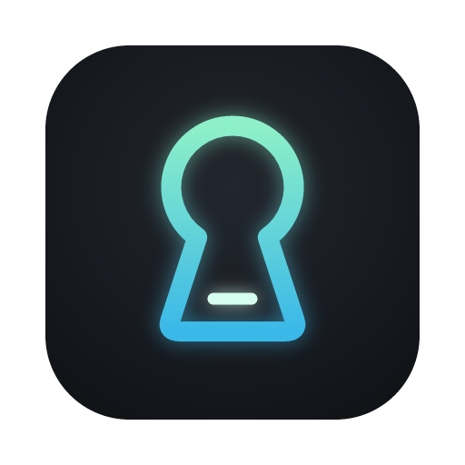
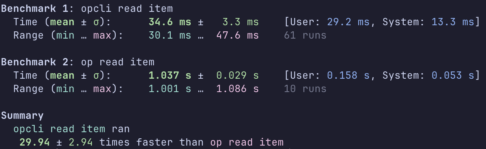

<p align="center"></p>

# opcli

A fast, local 1Password CLI alternative. Reads directly from 1Password's local SQLite database instead of making network calls.

## Performance

~30x faster than the official `op` CLI:



## How it works

1. Gets your account password from you, saves it in Keychain
2. Reads the local 1Password SQLite database
3. Derives the Account Unlock Key using 2SKD (HKDF + PBKDF2)
4. Decrypts the keyset chain (AES-256-GCM + RSA-OAEP)
5. Decrypts vault keys and item data

No network calls. No IPC with the desktop app. Just direct crypto.

## Installation

Download the [latest release](https://github.com/jeremyschlatter/opcli/releases/latest) from GitHub.

Or build from source:

```bash
make
make sign SIGN_IDENTITY="Developer ID Application: Your Name (TEAMID)"
```

The build requires Xcode Command Line Tools and Go 1.21+.

### Code Signing (required for Touch ID)

For Touch ID support, the binary must be signed with a Developer ID certificate.

The release binary is signed with my certificate. To build from source you will need your own.

## Usage

```bash
# First time: sign in (stores credentials in Keychain)
opcli signin

# Read a field from an item (prompts Touch ID on first use per terminal)
opcli read "op://VaultName/ItemName/fieldname"

# Read a field in a section
opcli read "op://VaultName/ItemName/SectionName/fieldname"

# Read from a specific account (by shorthand, email, UUID, or URL)
opcli read "op://AccountName:VaultName/ItemName/fieldname"
opcli read "op://AccountName:VaultName/ItemName/SectionName/fieldname"

# List all vaults
opcli list

# Dump an item as JSON
opcli get "op://VaultName/ItemName"

# Remove credentials from Keychain
opcli signout
```

### Git commit signing

`opcli ssh-sign` signs a file with an SSH key stored in 1Password, using the
same arguments and output format as `ssh-keygen -Y sign`. This lets it stand in
for the 1Password SSH agent as git's signing program:

```bash
# ~/bin/git-sign (git runs this as: git-sign -Y sign -n git -f <pubkey> [-U] <file>)
#!/bin/sh
exec opcli ssh-sign "op://Private/My SSH Key/private_key" "$@"
```

```ini
# ~/.gitconfig
[gpg]
    format = ssh
[gpg "ssh"]
    program = ~/bin/git-sign
[user]
    signingkey = ssh-ed25519 AAAA...
[commit]
    gpgsign = true
```

Unlike the 1Password agent, the Touch ID prompt belongs to the `opcli` process,
so killing it (say, with `timeout`) takes the prompt down with it. Sessions
apply as usual: one approval covers 10 minutes of commits from that terminal.

When Touch ID doesn't authenticate, because the prompt was cancelled or macOS
wouldn't show it (for example while the screen is locked), every opcli command
exits with status **3**. Any other error exits with 1. A wrapper can commit
unsigned on 3 and still fail loudly when signing is actually broken.

### Shell plugins

`opcli plugin` authenticates other CLIs (`gh`, `fly`, `codex`, ...) with
credentials from 1Password, like [`op plugin`](https://developer.1password.com/docs/cli/shell-plugins)
does. The plugins are the same ones: [1Password/shell-plugins](https://github.com/1Password/shell-plugins)
is compiled in (`make update-plugins` pulls the latest).

```bash
opcli plugin list              # every CLI there's a plugin for
opcli plugin init gh           # choose the 1Password item that holds gh's token
opcli plugin run -- gh pr list # run gh with that token
opcli plugin inspect gh
opcli plugin clear gh [--all] [--force]
```

`init` adds an alias (`gh` → `opcli plugin run -- gh`) to `~/.opcli/plugins.sh`
for your shell's startup file to source. The chosen item is used for the
current terminal session, a directory tree (`.opcli/plugins/` in it), or
globally (`~/.opcli/plugins/`).

An alias only works in an interactive shell. For scripts and coding agents,
use a shim instead: a symlink to opcli named for the executable, in a directory
ahead of the real one on your `PATH`. Run through it, opcli acts as
`opcli plugin run -- <name>`, and finds the real executable further along the `PATH`.

```bash
mkdir -p ~/.opcli/shims && ln -s "$(which opcli)" ~/.opcli/shims/gh
export PATH="$HOME/.opcli/shims:$PATH"
```

Differences from `op`:

- opcli is read-only, so `init` can't import a credential into 1Password or
  rename an item's fields to what a plugin expects. Instead it asks which of
  the item's fields to use and remembers that. And when the CLI's current
  credential (from its config file or environment) is already in 1Password,
  the items holding it are listed first.
- Shims (above) are an opcli addition.
- Configuration lives under `.opcli`, not `.op`. The format is op's, plus the
  field choices.
- Not supported yet: plugins that take a choice of other plugins' credentials
  (`terraform`, `tofu`), one-time-password fields, and the cache that lets a
  plugin reuse temporary credentials between runs (both matter for `aws` with MFA).

### Secret reference format

```
op://[account:]vault/item/[section/]field
```

> **Note:** The optional `account:` prefix is an opcli extension. The official 1Password CLI (`op`) does not support account names in `op://` references — it uses the `--account` flag or `OP_ACCOUNT` env var instead. opcli supports those too, but embedding the account in the reference is often more convenient.

Account-qualified references work everywhere `op://` refs are supported: `read`, `inject`, `run` (env vars, `--env-file`, and arg substitution).

### Auto-resolving accounts (`OPCLI_AUTO_ACCOUNT`)

Set `OPCLI_AUTO_ACCOUNT=1` to automatically resolve which account a vault belongs to when no account is specified. If the vault name is unambiguous across your signed-in accounts, opcli will use the correct one. If the vault exists in multiple accounts, you'll get an error asking you to specify the account explicitly.

## Security

### Touch ID

We unfortunately cannot integrate with the 1Password Desktop App for account unlocking, so `opcli signin` will require you to enter your account password.

Your account password is stored in the macOS Keychain with an app-only ACL. After this, `opcli` will always use TouchID to authenticate you. If any other app tries to read your account password from the Keychain, macOS will give you a Keychain password prompt:

> `app` wants to use your confidential information stored in "opcli credentials" in your keychain.

...which you should deny.

### Sessions

Each terminal session requires Touch ID authentication on first access. After authenticating:
- The session lasts for **10 minutes of inactivity**
- Hard limit of **12 hours** before re-authentication is required
- Each terminal window/tab has its own session

This mirrors the UX of the official `op` CLI's desktop app integration.

## Requirements

- macOS
- 1Password 8 desktop app installed (creates the local database)

## Limitations

- macOS only
- Read-only (no write operations)

## Why Not Desktop App Integration?

The official `op` CLI can avoid password prompts by integrating with the 1Password desktop app.

Unfortunately for us, but fortunately for 1Password security in general, the desktop app requires a code signature from Agile Bits before accepting a connection from the CLI. If `opcli` does extremely well, maybe we can get Agile Bits to adopt it some day. Until then, we're stuck with managing the account password ourselves.

## License

MIT
